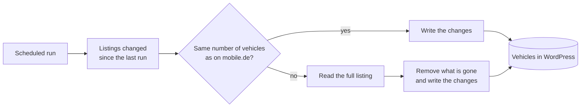

<div align="center">


# mobile.de Sync

**A dealer's mobile.de inventory on a WordPress site — synced, searchable and ready for enquiries.**

[](https://github.com/dmnktoe/wp-mobile-de-sync/releases/latest)
[](https://github.com/dmnktoe/wp-mobile-de-sync/actions/workflows/ci.yml)
[](https://wordpress.org/)
[](https://www.php.net/)
[](https://www.gnu.org/licenses/gpl-2.0.html)

[Project page](https://dmnktoe.github.io/wp-mobile-de-sync/) ·
[Download](https://github.com/dmnktoe/wp-mobile-de-sync/releases/latest) ·
[Changelog](CHANGELOG.md) ·
[Documentation](#documentation)

<br>


</div>

<br>

The plugin reads a dealer's inventory from the **mobile.de Search API** on a
schedule and keeps it in WordPress as ordinary posts: every listing becomes a
vehicle page, every sold vehicle disappears again. It brings its own vehicle
overview with filters, a detail page with gallery and enquiry form, blocks and
shortcodes — and works with any theme, including block themes.

## Highlights

**Sync that looks after itself**
- Changes-only runs on a schedule (every 5 minutes to once a day), a full reconciliation daily.
- A vehicle taken off mobile.de leaves the site **with the next run** — each run compares the size of the inventory and reads the full listing when it differs.
- Large inventories are processed in batches across several runs; nothing times out.
- Three guards against mass deletion, a lock against overlapping runs, a log, and an e-mail when the sync stops.

<p align="center"></p>

**A website that is ready**
- Vehicle overview at `/fahrzeuge/` with search, dropdowns, checkboxes and range sliders — counts per option, filters in the URL, no FacetWP needed.
- Detail page with gallery, key facts, equipment, emission sticker, manufacturer logo and **similar vehicles**.
- The address of a removed vehicle leads to the overview with a note instead of "page not found".
- `Car` / `Offer` structured data, Open Graph and Twitter cards.
- Every template can be overridden in the theme; colours and radii are CSS custom properties.

**Enquiries that do not get lost**
- A form on every vehicle page; the mail names the vehicle and replies go to the enquirer.
- Every enquiry is also stored in WordPress, marked **new** until answered, with a count in the menu and a reply button.
- Spam protection without captcha: honeypot, minimum fill time, rate limit, an
  ALTCHA-style proof of work, spam words and a blocklist that learns from
  "Mark as spam". Spam is kept aside, mailed to nobody and deleted after 30 days.
- Contact Form 7 integration and a mail-delivery check with test mail.

<p align="center"></p>

**An admin that tells you what is going on**
- One health verdict everywhere: admin bar, dashboard widget, notice, overview tab.
- Five tabs: Overview · Settings · Enquiries · Embedding · Tools & system.
- WP-CLI for the initial import and for scripts.

## Requirements

| | |
|---|---|
| WordPress | 5.8 or newer — classic and block themes |
| PHP | 7.0 or newer (CI runs 7.0, 7.4 and 8.3) |
| PHP extensions | `json`, `curl` or `allow_url_fopen`, `gd` or `imagick` |
| mobile.de | Search API access (username, password) and the dealer's seller ID |
| Network | outbound HTTPS to `services.mobile.de` |

## Getting started

1. **Install** — download `wp-mobile-de-sync.zip` from the [latest release](https://github.com/dmnktoe/wp-mobile-de-sync/releases/latest) and upload it under *Plugins → Add New → Upload Plugin*. Updates then arrive like any other plugin update.
2. **Connect** — *Vehicles → Sync Settings → Settings*: API username, password and seller ID.
3. **Test** — *Tools & system → Test connection* should answer *Connection OK – N vehicles in the inventory*.
4. **Import** — *Overview → Sync now*, or for a large inventory on the command line:
   ```sh
   wp wmds sync --full --all
   ```
5. **Done** — the vehicles are at `/fahrzeuge/`, and the schedule keeps them current.

The overview carries a checklist through these steps until the first import
has run. Deactivate any other mobile.de importer first: two importers on the
same post type overwrite each other.

## How the sync works



A run fetches only what changed since the last one, then asks mobile.de for
the size of the whole inventory in one small request. If the site would not
hold the same number afterwards, the run reads the full listing and removes
the vehicles that are gone — so a sold vehicle leaves the site with the next
scheduled run. Once a day a full reconciliation runs in any case. Removed
vehicles go to the trash and their pictures are deleted.

More in **[docs/sync.md](docs/sync.md)**: scheduling with a real cron job,
the safety guards, error handling and the e-mail alerts.

## On your site

The overview at `/fahrzeuge/` and every vehicle page work without anything to
set up. To place vehicles anywhere else:

| Block (inserter → *mobile.de Sync*) | Shortcode |
|---|---|
| Vehicles | `[vehicles posts_per_page="6" columns="3"]` |
| Vehicle filter | `[vehicle-filter layout="sidebar"]` |
| Vehicle count | `[vehicle-count]` |
| Vehicle enquiry | `[vehicle-enquiry]` |

```text
[vehicles filters="yes" pagination="yes" posts_per_page="12"]
[vehicles make="Audi" fuel="Diesel"]
[vehicle-logo make="BMW" width="40"]
```

Templates, styling, filters and structured data: **[docs/website.md](docs/website.md)**.

## Documentation

| | |
|---|---|
| [Sync](docs/sync.md) | schedule, cron, removal guards, error handling, alerts, WP-CLI, limits |
| [Website](docs/website.md) | templates, styling, filters, shortcodes, blocks, logos, structured data |
| [Enquiries](docs/enquiries.md) | the enquiry form, status and replies, Contact Form 7, mail delivery |
| [Admin](docs/admin.md) | the settings tabs, admin bar, dashboard widget, vehicle list |
| [Hooks](docs/hooks.md) | every filter and action the plugin offers |
| [Development](docs/development.md) | architecture, tests, translations, releasing |

## Language

The plugin is written in English and ships with a **German translation**.
Vehicle labels (fuel, transmission, colours …) come from mobile.de in the
language set under *Settings*, by default the site language.

## Development

```sh
sh tests/run.sh               # all tests — no WordPress, PHPUnit or Composer needed
sh tests/integration/run.sh   # end to end against a real WordPress and a mock API
composer install && composer lint
```

See **[docs/development.md](docs/development.md)** for how the code is put together,
and **[AGENTS.md](AGENTS.md)** for the rules every change follows.

## License

[GPL-2.0-or-later](https://www.gnu.org/licenses/gpl-2.0.html) ·
made by [Domenik Töfflinger](https://github.com/dmnktoe)

<sub>Not affiliated with mobile.de. Access to the Search API is arranged with mobile.de directly.</sub>
