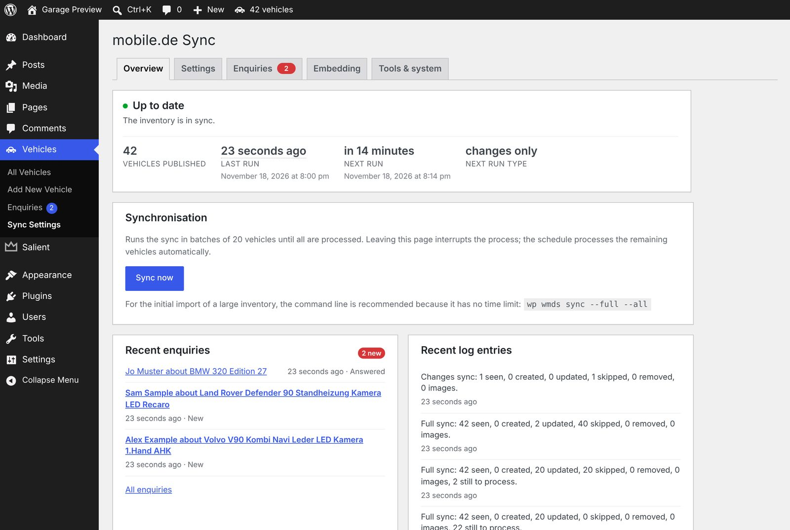

# Admin

[← README](../README.md)

## One verdict, everywhere

The sync has one health verdict — not configured, running, waiting for the
first run, in progress, overdue, last run had failures, up to date — and every
surface reads it from the same place, so they cannot contradict each other:

- an **admin bar item** with the inventory size and a coloured state, in the
  back end and on the front end. Its menu carries the last result, the time
  until the next run, *Sync now*, and on a vehicle page a link to the source ad
  plus a reload for that one vehicle
- a **dashboard widget** with the newest vehicles — photo, price, mileage,
  first registration — configurable in count and sort order
- an **entry in "At a Glance"** with the number of published vehicles
- a **notice on every admin screen** when the sync needs attention,
  dismissible, and re-armed when the state changes to something else

## The settings screen

*Vehicles → Sync Settings* has five tabs:

| Tab | Holds |
|---|---|
| **Overview** | the status, the getting-started checklist, *Sync now* with live progress, the newest enquiries and log entries — the page it opens on |
| **Settings** | credentials and which inventory, interval and label language, the address on the site, similar vehicles, notifications about problems |
| **Enquiries** | the form on a vehicle page, its recipients and privacy notice, mail delivery and the test mail |
| **Embedding** | blocks, shortcodes and widgets; Contact Form 7 and FacetWP |
| **Tools & system** | the connection test, maintenance, the log, the server requirements, version and help |

*Sync now* drives one batch per request and shows real progress instead of a
spinner over a request that may time out. The log can be filtered down to
problems, downloaded and cleared. Maintenance offers forcing a full sync,
re-fetching the reference data, deleting pictures of vehicles that are no
longer on the site, and releasing a lock a killed run left behind.

## Vehicles and enquiries

The **vehicle list** shows photo, make and model, price, mileage, first
registration and the mobile.de ad ID. Price, mileage and first registration are
sortable; vehicles missing the sorted-on value stay in the list rather than
falling out of it. A filter by make sits next to the date filter, and each row
offers *Reload from mobile.de* and *View on mobile.de*.

The **edit form** says outright that the importer owns the record, and a meta
box shows the ad ID, the modification date, the number of imported photos and
a button that re-reads this one vehicle.

The **enquiry list** shows status, contact and vehicle, with *Reply* and *Mark
as answered* on every row. The count of unanswered enquiries sits next to the
menu entry. See [Enquiries](enquiries.md).
